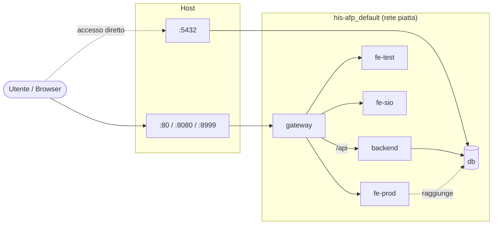
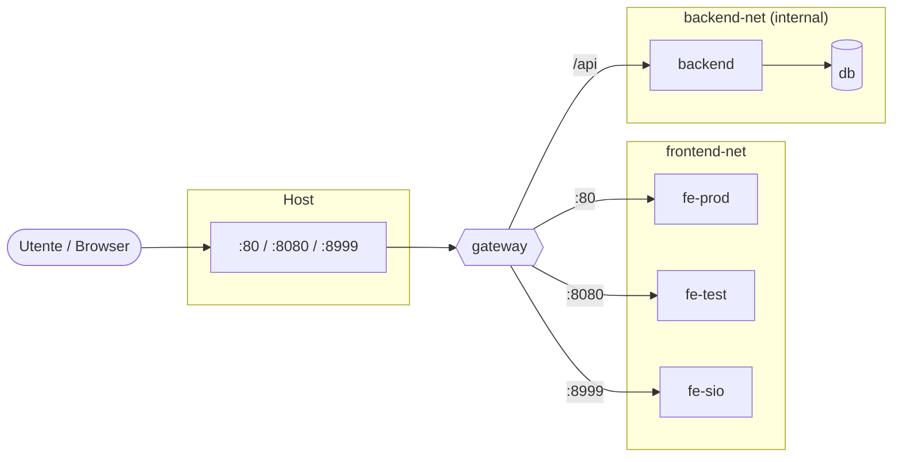

# 🛡️ Migrazione infrastrutturale – Isolamento delle reti

- **Task:** UF14 – Task 1, Isolamento infrastrutturale e protezione del dato sanitario
- **File modificato:** `docker-compose.yml`

---

## 1. Obiettivo

Trasformare la rete "piatta" del sistema HIS-AFP in un'architettura **multi-tier a compartimenti stagni**:

- i portali frontend (`fe-prod`, `fe-test`, `fe-sio`) in una rete dedicata alla distribuzione dei contenuti;
- backend e database in una rete protetta;
- il **gateway** come unico punto di contatto tra le due zone e unico container che pubblica porte verso l'host.

Vincolo di sicurezza: dal container `fe-prod` il database deve risultare **inesistente**, sia per nome (DNS) sia per indirizzo IP.

---

## 2. Architettura prima della migrazione

Il `docker-compose.yml` non dichiarava reti: Docker Compose collegava tutti i servizi alla rete predefinita `his-afp_default`.



| Problema | Conseguenza |
|---|---|
| Tutti i container nella stessa rete | Ogni container risolve e raggiunge tutti gli altri: da un frontend compromesso il database è a un passo |
| Database pubblicato sulla porta `5432` dell'host | Il database è interrogabile da fuori Docker, scavalcando backend e gateway |
| Nessuna separazione tra presentazione e dati | Una vulnerabilità nel livello meno critico (frontend statico) espone il livello più critico (dati sanitari) |

---

## 3. Architettura dopo la migrazione



### Servizi e reti

| Servizio | `frontend-net` | `backend-net` | Porte pubblicate sull'host |
|---|:---:|:---:|---|
| `gateway` | ✅ | ✅ | `80`, `8080`, `8999` |
| `fe-prod`, `fe-test`, `fe-sio` | ✅ | ❌ | nessuna |
| `backend` | ❌ | ✅ | nessuna |
| `db` | ❌ | ✅ | nessuna |

### Modifiche apportate

1. **Due reti nominate** dichiarate nel `docker-compose.yml`: `frontend-net` e `backend-net`.
2. **Segregazione dei servizi**: ogni servizio è collegato solo alla rete che gli serve; il gateway è l'unico collegato a entrambe.
3. **Hardening del database**: rimossa la pubblicazione della porta `5432`; rimossa anche la mappatura commentata della porta `3000` del backend.
4. **`backend-net` interna** (`internal: true`): Docker non fornisce a questa rete alcuna uscita verso l'esterno. Backend e database possono comunicare solo tra loro e con il gateway; anche un processo compromesso al loro interno non può aprire connessioni verso internet (es. per esfiltrare dati). Il gateway continua a pubblicare le sue porte tramite `frontend-net`.
5. **`backend` aggiunto ai `depends_on` del gateway**: NGINX risolve i nomi degli upstream all'avvio; avviare prima il backend evita che il gateway fallisca e debba ripartire.

### Come funziona l'isolamento

Ogni rete Docker definita dall'utente ha un proprio DNS interno che risolve **solo** i nomi dei container collegati a quella rete. Reti diverse sono bridge diversi, tra i quali Docker non instrada traffico. Di conseguenza da `fe-prod`:

- il nome `db` (o `sio-postgres`) **non viene risolto** (`NXDOMAIN` / `bad address`);
- anche conoscendo l'indirizzo IP del database, i pacchetti **non arrivano** (100% persi).

L'isolamento avviene quindi a livello di rete, non di applicazione: non dipende da password o configurazioni del database.

> ℹ️ Nell'output di `docker ps` compaiono anche voci come `3000/tcp` o `5432/tcp` per backend e database: sono le porte dichiarate con `EXPOSE` nell'immagine, un'informazione descrittiva. Una porta è **pubblicata** sull'host solo quando appare la mappatura `0.0.0.0:<porta>->`; il comando `docker port <container>` mostra solo quelle.

---

## 4. Perché abbiamo eseguito la migrazione

- **Riduzione della superficie d'attacco**: un attaccante che compromette un frontend non vede il database e non può attaccarlo direttamente.
- **Difesa in profondità**: anche se le credenziali del database venissero esposte, mancherebbe la strada per usarle dall'host o dai frontend.
- **Punto di controllo unico**: tutto il traffico verso il backend passa dal gateway, dove si possono concentrare log, limiti e controlli.
- **Requisito di accreditamento**: l'audit di sicurezza sanitario richiede la separazione tra la zona di presentazione e quella che contiene i dati dei pazienti.
- **Costo minimo**: la migrazione richiede poche righe nel `docker-compose.yml`, nessuna modifica al codice applicativo e nessun impatto sulle prestazioni.

### Cosa questa migrazione NON risolve

Va dichiarato apertamente per non dare un falso senso di sicurezza:

- **L'API resta raggiungibile tramite il gateway.** Da `fe-prod` è ancora possibile chiamare `http://sio-gateway/api/...`, ed è inevitabile: è la stessa strada usata dai browser. L'isolamento protegge il database, non l'API. Con l'autenticazione disattivata (`AUTH_ENABLED: "false"`) chiunque raggiunga il gateway può leggere e modificare i dati tramite l'API.
- **Il gateway diventa un punto critico**: se viene compromesso, ha accesso a entrambe le reti; se si ferma, si ferma tutto il sistema.
- **I tre ambienti condividono lo stesso backend e lo stesso database** (vedi §5).

---

## 5. Limiti riscontrati e proposte di miglioramento

| # | Limite | Perché è un problema | Proposta |
|---|---|---|---|
| 1 | **Produzione, test e sviluppo usano lo stesso backend e lo stesso database** | I dati di prova si mescolano con i dati reali dei pazienti; un errore in sviluppo può corrompere la produzione. È il limite più grave dell'architettura attuale | Un backend e un database per ambiente, in reti separate (o in stack/namespace distinti) |
| 2 | **Autenticazione disattivata** (`AUTH_ENABLED: "false"`) | L'isolamento di rete protegge il database ma non l'API, che resta aperta a chiunque raggiunga il gateway | Riattivare l'autenticazione JWT e aggiungere controllo dei ruoli |
| 3 | **Credenziali in chiaro nel `docker-compose.yml`** (password del database, segreto JWT) | Chiunque legga il repository conosce le credenziali | File `.env` escluso da git o, meglio, Docker secrets / un secret manager (es. Vault) |
| 4 | **Nessun healthcheck** e `depends_on` basato solo sull'ordine di avvio | Un servizio "avviato" non è necessariamente "pronto" (es. Postgres in inizializzazione): il backend o il gateway possono partire troppo presto | `healthcheck` sui servizi e `depends_on` con `condition: service_healthy` |
| 5 | **Traffico solo HTTP**, senza TLS | Dati sanitari in chiaro sulla rete | Terminazione HTTPS sul gateway con certificati gestiti automaticamente |
| 6 | **Configurazione NGINX scritta a mano**, con upstream fissi e risolti all'avvio | Ogni nuovo servizio o ambiente richiede di modificare e ricaricare il gateway | Ingress controller dinamico come **Traefik**, che legge il routing dalle label dei container |
| 7 | **Variabili d'ambiente iniettate all'avvio** (`env.js` generato con `envsubst`) | Per cambiare un comportamento serve riavviare il container | **Feature flags dinamici** letti a runtime da un servizio dedicato (es. Unleash, flagd) |
| 8 | **Build non riproducibili**: `npm install` invece di `npm ci`, immagini `latest` / `nginx:alpine` senza versione | La stessa build può produrre risultati diversi in momenti diversi | `npm ci`, tag di versione fissi, `.dockerignore` |
| 9 | **Container eseguiti come root** e senza limiti di risorse | Un processo compromesso ha più privilegi del necessario | Utente non root, `read_only`, limiti di CPU/memoria |

### Evoluzione proposta

Per un sistema sanitario in produzione, Docker Compose su un singolo host resta adatto allo sviluppo e alla didattica, ma mostra i suoi limiti in termini di alta disponibilità e gestione degli ambienti. L'evoluzione naturale è:

1. **Breve termine (sempre con Compose)**: correggere i punti 2, 3, 4 e 8, che non richiedono cambi di piattaforma.
2. **Medio termine**: introdurre **Traefik** come gateway, con HTTPS automatico e routing dichiarato tramite label, e separare database e backend per ambiente.
3. **Lungo termine**: migrare a **Kubernetes**, dove:
   - i tre ambienti diventano **namespace** separati;
   - l'isolamento di questa task si esprime con le **NetworkPolicy** (es. "solo i pod del backend possono contattare il database sulla porta 5432"), più granulari delle reti Docker;
   - il gateway diventa un **Ingress Controller**;
   - credenziali e configurazione passano da **Secret** e **ConfigMap**, i feature flags da un servizio dedicato;
   - repliche e health probe garantiscono l'alta disponibilità.

Il passaggio a Kubernetes ha però un costo di complessità e di competenze non trascurabile: è giustificato solo quando servono alta disponibilità, scalabilità o più nodi. Per l'attuale dimensione del progetto, i miglioramenti del punto 1 danno il maggior beneficio con il minor costo.

---

## 6. Guida ai test

Tutti i comandi si eseguono dalla cartella principale del progetto. Le verifiche sul traffico passano **dal gateway**; `docker exec` si usa solo per simulare un utente o un processo che si trova *dentro* un container.

### 6.1 Avvio pulito

```bash
docker compose down
docker compose up -d --build
```

> Il `down` è necessario se lo stack era già attivo con la vecchia configurazione: una rete esistente non può diventare `internal` senza essere ricreata.

### 6.2 Reti e servizi collegati

```bash
docker network inspect his-afp_frontend-net -f '{{range .Containers}}{{.Name}} {{end}}'
docker network inspect his-afp_backend-net -f '{{range .Containers}}{{.Name}} {{end}}'
docker network inspect his-afp_backend-net -f '{{.Internal}}'
```

**Atteso:** `frontend-net` contiene `sio-fe-prod`, `sio-fe-test`, `sio-fe-sio` e `sio-gateway`; `backend-net` contiene `sio-backend`, `sio-postgres` e `sio-gateway`; l'ultimo comando stampa `true`.

### 6.3 Il gateway è l'unico container con porte pubblicate

```bash
for c in sio-gateway sio-backend sio-postgres sio-fe-prod sio-fe-test sio-fe-sio; do echo "$c: $(docker port $c | tr '\n' ' ')"; done
nc -z -w 2 localhost 5432 && echo APERTA || echo CHIUSA
```

**Atteso:** solo `sio-gateway` mostra porte (`80`, `8080`, `8999`); tutti gli altri hanno la riga vuota. La porta 5432 risulta `CHIUSA`.

### 6.4 Il sistema funziona passando dal gateway

```bash
for p in 80 8080 8999; do echo "porta $p: $(curl -s -o /dev/null -w '%{http_code}' http://localhost:$p/)"; done
curl -s http://localhost/api/health
```

**Atteso:** i tre portali (produzione, test, sviluppo) rispondono `200`; l'health check restituisce `"database":"CONNECTED"`, a conferma che il percorso gateway → backend → database funziona.

### 6.5 Validazione: il database è inesistente per il frontend di produzione

```bash
docker exec sio-fe-prod nslookup db
docker exec sio-fe-prod ping -c 1 db
```

**Atteso:** `nslookup` risponde `server can't find db: NXDOMAIN`; `ping` risponde `ping: bad address 'db'`. Il nome del database non esiste nella rete del frontend.

Prova anche con l'indirizzo IP, per dimostrare che l'isolamento non dipende solo dal DNS:

```bash
DB_IP=$(docker inspect sio-postgres -f '{{range .NetworkSettings.Networks}}{{.IPAddress}}{{end}}')
docker exec sio-fe-prod ping -c 1 -W 2 "$DB_IP"
```

**Atteso:** `1 packets transmitted, 0 packets received, 100% packet loss`.

> Lo stesso risultato si ottiene sostituendo `sio-fe-prod` con `sio-fe-test` o `sio-fe-sio`.

### 6.6 La rete protetta non ha accesso verso l'esterno

```bash
docker exec sio-backend node -e "fetch('https://example.com').then(()=>console.log('RAGGIUNTO')).catch(()=>console.log('BLOCCATO'))"
```

**Atteso:** `BLOCCATO`. Backend e database non possono aprire connessioni verso internet.
